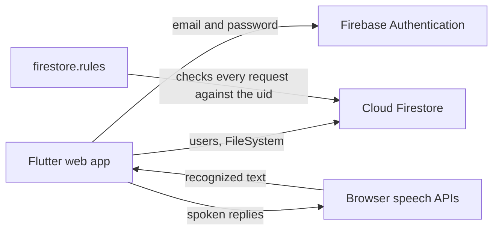

# HoneyOS

[](https://github.com/Exalt24/HoneyOS/actions/workflows/ci.yml)

A voice-driven desktop operating-system simulation in Flutter: boot, pick a user, log in, and manage files by talking to it.


*A Flutter web build against the Firebase emulators on one machine: register, log in, the date by voice, then a folder and a file that persist. The microphone is stubbed in the recording (two spoken commands are injected); everything else is real clicks and typing. [Full quality mp4](docs/demo.mp4).*

12 unit and widget tests pass, `flutter analyze` reports no issues, and 24 security-rule checks pass against both the emulator and a real Firebase project on the free Spark plan.

## What it is

HoneyOS started as a university project about modelling an operating-system interface with voice as the main input. It boots into a hexagon user picker, logs users in, and gives each of them a small file system. You say "Honey, tell me the date, please" and the assistant answers; a command has to start with "honey" and end with "please".

- **Users.** A honeycomb of up to 10 slots. An empty slot is a "+" that opens registration: a username (10 characters at most), a password (6 to 10) and an optional profile picture.
- **Home screen.** A clock and six tiles: Tell me about Honey, Open a File, Create a File, Tell me the Date, View Files and Buzz Out. Speech recognition (`speech_to_text`) and spoken replies (`flutter_tts`) drive the same actions.
- **Files.** View Files shows the disk ("Local Disk C"). Inside it you create folders and text files, open them, and edit in a small editor with Save, Save As, Undo and Redo. Everything is stored in Cloud Firestore and belongs to the user who made it.

## What changed in the October 2026 rebuild

The original app was written against Firebase packages from early 2024 and an old Firebase project whose API key had been committed. I rebuilt it so a fresh clone runs on a new project and nothing project-specific is in git.

| Before | Now |
| --- | --- |
| Firebase key and `google-services.json` in the repo | Config comes from a git-ignored `config/firebase.json` passed with `--dart-define-from-file`; the repo holds only `config/firebase.example.json` |
| Users were Firestore documents with the password stored as plain text | Firebase Authentication (email and password). The username is mapped to a fixed address of the form `<hex of the username>@honeyos.invalid`; no password is stored anywhere in Firestore |
| Rules were wide open because there was no identity to check | `firebase/firestore.rules`: a user can only read, create, rename and delete their own folders and files; the profile list is public because the picker needs it before anyone signs in |
| Profile pictures in Cloud Storage | A 128 px PNG inside the user document. Cloud Storage now requires a paid plan on new projects, and this keeps the whole app on the free Spark plan |
| `firebase_core` 2, `cloud_firestore` 4, `file_picker` 8, `speech_to_text` 6 and the rest | Current majors: `firebase_core` 5, `cloud_firestore` 7, `firebase_auth` 7, `file_picker` 13, `speech_to_text` 7, `open_file` 4, `flutter_lints` 6 (Flutter 3.47, Dart 3.13) |
| `dart:js` to close the tab, 163 analyzer findings | `package:web` behind a conditional import (so tests run on the Dart VM), no analyzer findings |
| The default Flutter counter test | 12 tests: voice-command parsing, account rules and the boot and setup screens |

The first sign-in on a brand-new project creates the shared disk document by itself (the rules allow exactly that one document), so there is no seed script any more.

## Architecture



`lib/core/` holds the pure Dart logic (voice-command parsing, username and password rules, avatar encoding). `lib/services/accounts.dart` is the only code that touches Authentication. `lib/UI/` has one file per screen.

## Run it locally with the emulators

You need the Flutter SDK, Node 18 or newer, JDK 21 or newer and Chrome or Edge. No Firebase account is involved.

```bash
npx firebase-tools emulators:start --only auth,firestore --project demo-honeyos --config firebase/firebase.json
```

In a second terminal:

```bash
flutter pub get
flutter build web --release --no-web-resources-cdn --dart-define=FIREBASE_EMULATOR_HOST=127.0.0.1
python -m http.server 8000 --directory build/web
```

Open http://localhost:8000 and allow the microphone when asked. If the default ports (8080 for Firestore, 9099 for Auth) are taken, change them in `firebase/firebase.json` and add `--dart-define=FIRESTORE_EMULATOR_PORT=<port> --dart-define=AUTH_EMULATOR_PORT=<port>` to the build.

## Run it against your own Firebase project

The free Spark plan is enough, and no payment method is needed.

1. Create a Firebase project and register a Web app.
2. Authentication: turn on the Email/Password provider.
3. Firestore: create a database, then publish `firebase/firestore.rules` (paste it in the Rules tab, or run `npx firebase-tools deploy --only firestore:rules --config firebase/firebase.json` with `--project` set to your project id).
4. Copy `config/firebase.example.json` to `config/firebase.json` and fill in the values from Project settings. The file is git-ignored.
5. Run it:

```bash
flutter run -d chrome --dart-define-from-file=config/firebase.json
```

A web API key identifies your project to the browser and is not a secret, but restrict it to your own site (Google Cloud console, Credentials, HTTP referrers). Without any config the app shows a short setup message instead of crashing.

Cloud Storage stays off, since the app does not need it.

## Tests

```bash
flutter analyze
flutter test
```

`test/core_test.dart` covers the voice-command parsing and the account rules; `test/widget_test.dart` checks the boot screen and the no-project setup screen. The security rules have their own end-to-end check that signs up two throwaway users and sends real requests (24 checks: who may read, create, rename and delete what):

```bash
node firebase/rules_check.mjs --emulator
node firebase/rules_check.mjs --config config/firebase.json
```

The second form runs against your hosted project and deletes everything it created. Add `REFERER=http://localhost:8000/` if you restricted the API key by referrer.

## Notes worth knowing

- **Web only.** The voice features use the browser's speech APIs, and the platform folders (`android`, `ios`, `windows` and so on) are the unmodified Flutter scaffold. Only the web target is built and tested.
- **The microphone path is checked with injected phrases.** Headless Chromium has no speech engine, so the recording and my checks inject recognized phrases. Live speech uses the recognizer that Chrome and Edge provide.
- **The profile list is public.** Names and small pictures are readable by anyone, because the user picker shows them before login. Passwords are never in Firestore.
- **A username is not a mailbox.** The generated address is never mailed, so there is no password reset.
- **Voice right after a screen change can be dropped.** The recognizer is shared between screens and needs a moment to hand over, so a command spoken in the first second on a new screen may be missed. Typing always works.
- **Free-tier ceilings apply:** Firestore's daily read and write quota on Spark, and the 1 MiB document limit (text files are capped at 200,000 characters by the rules).

## Security note

Earlier versions of this repo committed the Firebase client config of my original project (id `honeyos`), and that config is still in the git history. The app no longer uses it: it now runs on a different project whose config is never committed. I have not deleted the original project, and I cannot tell from outside whether it still exists, so treat its old key as public and its old data as readable. Firebase client keys identify a project rather than grant access to it; what protects data in a project is its rules, and the rules for the current setup are in `firebase/firestore.rules`.

## Stack

Flutter and Dart, `firebase_auth`, `cloud_firestore`, `firebase_core`, `speech_to_text`, `flutter_tts`, `file_picker`, `open_file`, `hexagon`, `package:web`.

## License

MIT, see [LICENSE](LICENSE).
